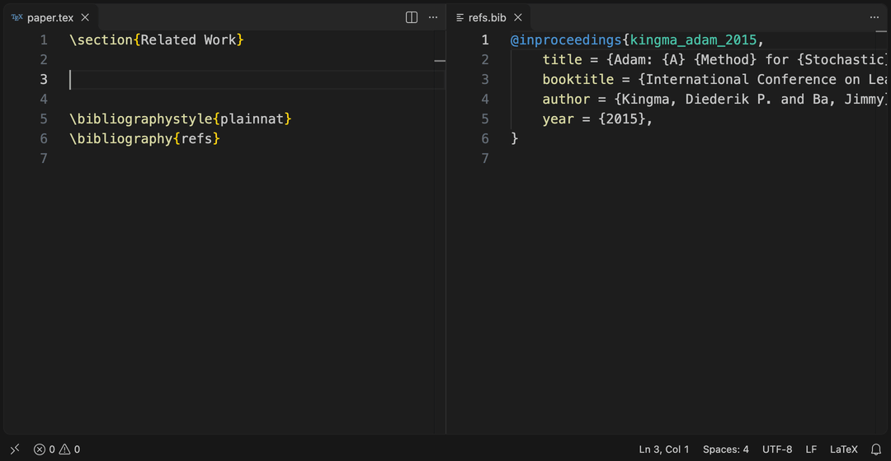

# Zotero Live Cite

Overleaf-style citation autocomplete for LaTeX in VS Code. Type `\cite{` and
start typing an author, a title word, a year or a key: suggestions come
straight from your running Zotero library. Picking one inserts the key and
adds that reference's BibTeX entry to your project's `.bib` file, unless it is
already there.



<sub>Recorded with a sample library (`npm run demo`).</sub>

No export step and no Better BibTeX: the extension talks to the Zotero app's
built-in local API, and keys are exactly what Zotero's own BibTeX export
produces (`lastname_titleword_year`, e.g. `vaswani_attention_2017`).

## Install

Run one of these commands in a terminal (macOS or Linux, bash or zsh). Each
fetches the packaged extension into a temporary folder, installs it into VS
Code and deletes the folder, so nothing is left in Downloads or anywhere else.
Run the same command again to update, then reload any open VS Code windows
(Command Palette → **Developer: Reload Window**).

**With git** (no GitHub account needed):

```bash
d=$(mktemp -d) && git clone -q --depth 1 --branch vsix https://github.com/justachetan/zotero-live-cite.git "$d" && code --install-extension "$d/zotero-live-cite.vsix" --force; rm -rf "$d"
```

If you use SSH with GitHub, replace the URL with
`git@github.com:justachetan/zotero-live-cite.git`.

**With the GitHub CLI**, signed in with `gh auth login`:

```bash
d=$(mktemp -d) && gh release download -R justachetan/zotero-live-cite -p '*.vsix' -D "$d" && code --install-extension "$d"/*.vsix --force; rm -rf "$d"
```

Both commands need VS Code's **`code` command** on your PATH (in VS Code:
Command Palette → **Shell Command: Install 'code' command in PATH**).

To uninstall:

```bash
code --uninstall-extension local.zotero-live-cite
```

## Set up Zotero

1. **Zotero 7 or later** must be running. Tested with Zotero 10.0.7.
2. In Zotero, open **Settings → Advanced** and tick **Allow other
   applications on this computer to communicate with Zotero**.
3. Optional: in VS Code, run **Zotero Live Cite: Select Collection to Search**
   from the Command Palette to limit suggestions to one collection
   (subcollections are included). The choice is saved in the workspace's
   `.vscode/settings.json`.

## Use

Inside any citation command (`\cite`, `\citep`, `\citet`, `\citeauthor`,
`\nocite`, `\textcite`, `\parencite`, `\Citep`, ...), type after `{` or a comma.
Suggestions marked **Zotero** come from your library; the right-hand text is
the paper's title. Typing part of a key works too: `vaswani_att` searches for
"vaswani att".

When you accept a suggestion, the entry is appended to the `.bib` file and
saved. If the `.bib` file had unsaved changes, the entry is added to the
buffer and left for you to save.

## Settings

| Setting | Default | Meaning |
| --- | --- | --- |
| `zoteroLiveCite.collection` | `""` (whole library) | Collection name (`Thesis`), path (`Reading List/Transformers`) or key. |
| `zoteroLiveCite.bibFile` | `""` (auto) | `.bib` file to append to, relative to the workspace folder. When empty, the workspace's only `.bib` file is used; with several, you are asked once per workspace. |
| `zoteroLiveCite.libraryUrl` | `http://127.0.0.1:23119/api/users/0` | Library to search. Use `http://127.0.0.1:23119/api/groups/<groupID>` for a group library. |

## How it works

```
keystroke inside \cite{...}
  → src/citeContext.ts   find the partial key under the cursor
  → src/zoteroClient.ts  GET <library>/items/top?q=...&include=data,bibtex
                         (one request per collection when a collection is set)
  → src/completion.ts    show results; VS Code re-asks on every keystroke
accept
  → src/bibWriter.ts     append the item's BibTeX to the .bib unless its key exists
```

Each search returns every item's BibTeX export alongside its metadata, so the
key you see is the key that lands in the `.bib`, and accepting needs no second
request. Zotero's quick search matches any co-author and sorts by date, so up
to 100 matches are fetched and ranked locally: keys that start with what you
typed come first, then keys containing every typed word, then the rest. Items
that export the same key (duplicates in your library) are offered once.
Searches against a local library take roughly 30–200 ms.

## Limitations

- Zotero must be running. If it isn't, or the local API is off, a warning says
  so once, and suggestions resume when Zotero is back.
- Zotero computes export keys per item, so two different items can get the
  same key (common with `noauthor_..._nodate`). If a key is already in the
  `.bib`, nothing is added or overwritten.
- The citation command and the key must be on the same line.
- With LaTeX Workshop installed, its suggestions from your `.bib` appear
  alongside these; keys already in the `.bib` can show twice.
- The extension is disabled in Restricted Mode (untrusted workspaces).

## Development

```bash
npm test                          # unit tests against a fake Zotero HTTP server
```

```bash
npm run test:vscode               # end-to-end test in a separate VS Code window
```

```bash
npm run smoke -- vaswani_att Thesis  # search your real Zotero library
```

```bash
npm run demo                      # re-record docs/demo.gif (needs ffmpeg)
```

Press F5 in VS Code to launch an Extension Development Host. The end-to-end
test uses `/Applications/Visual Studio Code.app` when present (override with
`VSCODE_EXECUTABLE`), and otherwise downloads VS Code into `.vscode-test/`.

To build and install from a clone instead of a release:

```bash
npm install && npm run package && code --install-extension zotero-live-cite-*.vsix --force
```

### Releasing

Bump `version` in `package.json`, commit and push to `main`, then run:

```bash
scripts/release.sh
```

It packages the extension and publishes the same `.vsix` twice: as a GitHub
release (for the `gh` install command) and on the `vsix` branch, which holds
only the latest `.vsix` (for the git install command).

## License

[MIT](LICENSE)
